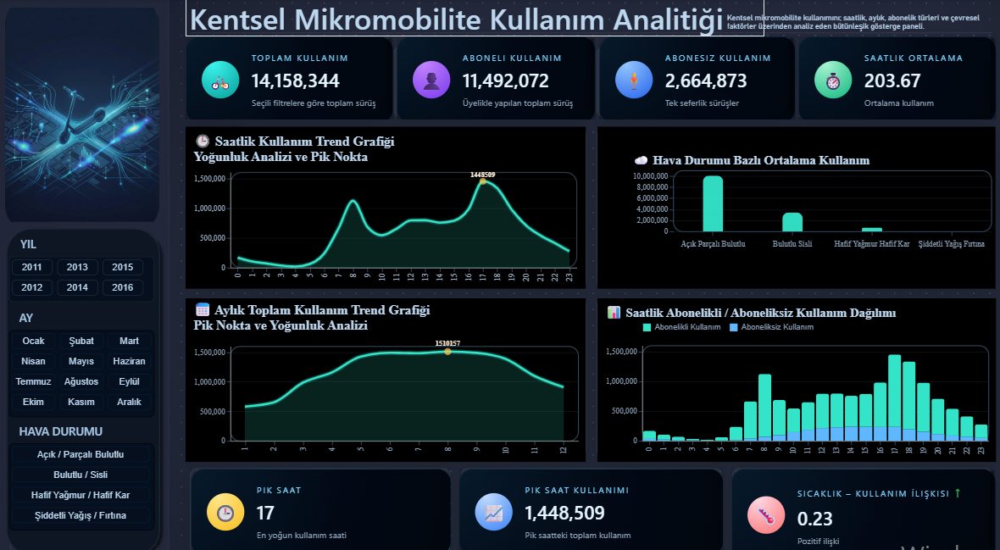

# Kentsel Mikromobilite Kullanım Analitiği — Power BI Dashboard

Saatlik paylaşımlı mikromobilite (bisiklet/scooter) kullanım verisini analiz eden interaktif bir Power BI raporu. Rapor; kullanımın saate, aya ve hava durumuna göre nasıl değiştiğini, abonelikli ve aboneliksiz kullanıcıların davranış farklarını tek sayfada özetler.

## Öne Çıkan Bulgular

- **2011–2016** dönemini kapsayan veride toplam **14.158.344** sürüş var. Bunların yaklaşık **%81'i (11.492.072)** abonelikli, **2.664.873**'ü aboneliksiz kullanım.
- Saatlik ortalama kullanım **203,67** sürüş.
- Gün içinde iki belirgin pik var: sabah **08:00** ve akşam **17:00**. En yoğun saat 17:00 (**1.448.509** sürüş). Bu tablo, kullanımın büyük ölçüde işe gidiş-dönüş amaçlı olduğunu gösteriyor.
- Aboneliksiz kullanım öğleden sonra saatlerine yayılırken, abonelikli kullanım sabah ve akşam piklerinde yoğunlaşıyor.
- Kullanım yaz aylarında zirve yapıyor (en yüksek ay: **Ağustos**) ve kış aylarında belirgin şekilde düşüyor.
- Sürüşlerin büyük çoğunluğu açık/parçalı bulutlu havada yapılıyor; yağış arttıkça kullanım sert biçimde azalıyor.
- Sıcaklık ile kullanım arasında **pozitif ama zayıf (0,23)** bir ilişki var.

## Dosya

| Dosya | Açıklama |
|---|---|
| `micromobility_ana_dosya.pbix` | Power BI Desktop rapor dosyası (veri modeli + rapor) |

> GitHub `.pbix` dosyalarını tarayıcıda önizleyemez. Raporu incelemek için dosyayı indirip **Power BI Desktop** ile açın.

## Rapor İçeriği — "Kullanım Özeti" sayfası

**KPI kartları**
- Toplam kullanım
- Abonelikli ve aboneliksiz kullanım
- Ortalama saatlik kullanım
- Pik saat ve pik saatteki kullanım
- Korelasyon göstergesi

**Grafikler**
- Saate göre toplam kullanım
- Saate göre abonelikli / aboneliksiz kullanım karşılaştırması
- Aylık toplam kullanım ve abonelikli kullanım trendi
- Hava durumuna göre ortalama kullanım

**Filtreler**
- Yıl
- Ay
- Hava durumu

## Kullanılan Araçlar ve Teknikler

- **Power BI Desktop**
- **DAX** — KPI ölçüleri, abonelik tipine göre kullanım, hava durumuna göre ortalama kullanım, korelasyon hesaplaması
- **Deneb (Vega-Lite)** — özelleştirilmiş grafikler
- **HTML Content** görseli — tasarımı özelleştirilmiş KPI kartları
- **Chiclet Slicer** — buton tipi filtreler
- Türkçe ay ve hava durumu etiketleriyle yerelleştirilmiş veri modeli

## Analiz Soruları

- Gün içinde talebin en yoğun olduğu saatler hangileri?
- Abonelikli ve aboneliksiz kullanıcıların kullanım saatleri nasıl farklılaşıyor?
- Kullanım aylara ve mevsimlere göre nasıl değişiyor?
- Hava durumu kullanımı ne ölçüde etkiliyor?

## Hazırlayan

**Gizem Sökmen** — Endüstri Mühendisi | Veri & İş Analitiği
